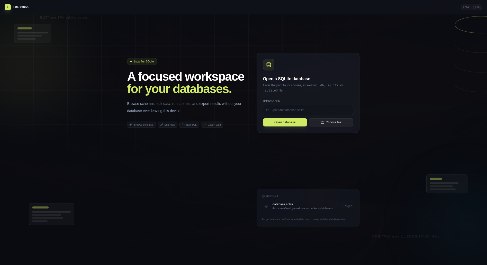
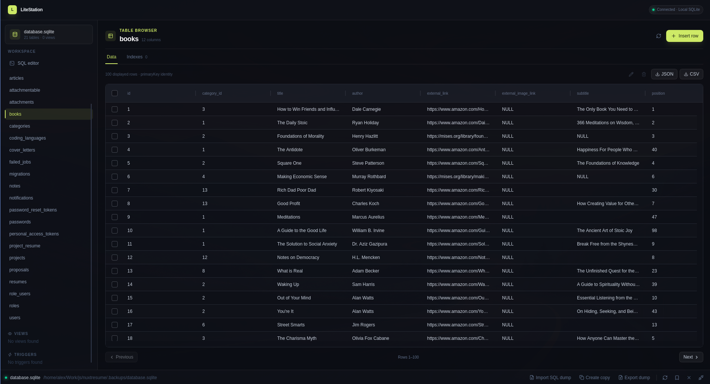

# LiteStation

**A SQLite tool that respects your database. And you.**

LiteStation is a native desktop app for SQLite. That's it. That's the pitch.
It's a SQL editor, a fast data grid, safe schema and data editing, and solid
import/export — running on *your* machine, with *your* data, under *your*
control.

No account. No cloud. No subscription with a "Pro" tier that unlocks the
UPDATE statement. Just a tool that does its job and gets out of the way.

Inspired by the focused feel of TablePlus, but opinionated where it counts:
LiteStation does SQLite, and only SQLite, and it does it *well*. The
everything-Database-in-one-IDE is somebody else's dream. Mine is a tool I
actually enjoy using every day.

## Screenshots

### Welcome screen



### Database workspace



## The problem with the alternatives

Most database GUIs want to be everything to everyone. Support forty engines,
sync your connections to the cloud, upsell you on collaboration features you
never asked for. The result is bloated, slow, and — here's the kicker — still
worse at the one job you opened it for.

LiteStation takes the opposite bet: do fewer things, completely. It's a
philosophy that's served open source well. Constraints are a feature.

## What you get

- **Open and browse** local SQLite databases — tables, views, indexes,
  triggers. Pick a path that doesn't exist and LiteStation refuses to
  pretend it does.
- **A real SQL editor.** CodeMirror syntax highlighting. Run the selected
  SQL, the statement under your cursor, or everything at once.
- **Safe data editing.** Insert, update, and delete with optimistic conflict
  checks, so you can't silently stomp on rows that changed underneath you.
  Destructive actions ask before they destroy.
- **Imports that don't lie to you.** SQL dumps apply atomically — a failed
  import never leaves a half-committed database behind. Importing another
  SQLite file copies it; the source is never touched, never merged.
- **Exports that don't trash your disk.** JSON, CSV, or a full SQL dump.
  Staged atomically, never overwriting what's already there.
- **Fast on big databases.** Results are paged and bounded. The backend
  enforces real limits on rows, cells, and payloads, instead of silently
  slurping ten million rows into your frontend.
- **Your connections, your business.** Saved and recent connections, kept
  locally. Explicit close, explicit forget.
- **Native, light and dark.** Linux, macOS, and Windows.

## Local-first is the point

Your database contents and connection details never leave your machine.
There is no LiteStation server. There is no telemetry pipeline. There is no
"anonymous analytics" checkbox buried in settings, because there are no
settings for it — there's no phoning home at all.

This is software the way it used to be made, and the way it should be: you
download it, you build it, you run it, it's yours.

## Build it yourself

LiteStation isn't on an app store. It doesn't need to be. It's a
[Tauri 2](https://v2.tauri.app/) app — Rust backend, Vue frontend, native
window — and building it on your own machine takes minutes, not an evening.

That's not a limitation. That's freedom. The binary is built from source
you can read, on the OS you use, with the system libraries you trust.

### Prerequisites

- **Rust** (current stable, via [rustup](https://rustup.rs/))
- **Node.js** with **pnpm**
- Your platform's system libraries — see the
  [Tauri prerequisites](https://v2.tauri.app/start/prerequisites/).
  On Linux that's the usual webkit and friends: `libwebkit2gtk-4.1-dev`,
  `build-essential`, `libssl-dev`, and neighbors.

### Build and run

```sh
git clone <repository-url>
cd litestation

# Install frontend dependencies
pnpm install

# Run it in dev mode — hot reload on the frontend, Rust debugging on the backend
pnpm tauri dev

# Or make a release build like a grown-up
pnpm tauri build
```

`pnpm tauri build` produces real artifacts — `.deb`/`.rpm`/AppImage on
Linux, `.app`/`.dmg` on macOS, an installer on Windows — under
`src-tauri/target/release/bundle/`. Alongside them sits a plain,
no-bundle binary you can run however you like.

Open one or more databases directly from the command line. If LiteStation is
already running, the databases open as tabs in its existing window:

```sh
litestation path/to/database.sqlite
litestation first.sqlite second.sqlite
```

Just want the frontend build, no packaging? Sure:

```sh
pnpm build
```

### Development commands

```sh
# Rust test suite
cargo test --workspace

# Frontend test suite
pnpm test

# Clean-code checks and TypeScript linting
pnpm test:cleancode
pnpm lint:oxlint
pnpm format:oxfmt

# Keep the Rust honest
cargo fmt --all -- --check
cargo clippy --workspace --all-targets --all-features -- -D warnings

# Fast debug build without the bundling step
pnpm tauri build --debug --no-bundle
```

## Stack

- [Tauri 2](https://v2.tauri.app/) — desktop shell
- [Rust](https://www.rust-lang.org/) with [rusqlite](https://github.com/rusqlite/rusqlite) — backend
- [Vue 3](https://vuejs.org/) and [TypeScript](https://www.typescriptlang.org/) — frontend
- [Vite](https://vitejs.dev/) and [pnpm](https://pnpm.io/) — tooling

## The roadmap is short on purpose

SSH connections to remote SQLite databases are coming. What's not coming:
other database engines, cloud sync, mobile apps, or a hosted version. When
your product is "a good local tool," a bigger roadmap is a bug, not a
feature.

Product direction, settled goals, and architecture decisions live in
[`CONTEXT.md`](CONTEXT.md). Contributions welcome. BS not.
